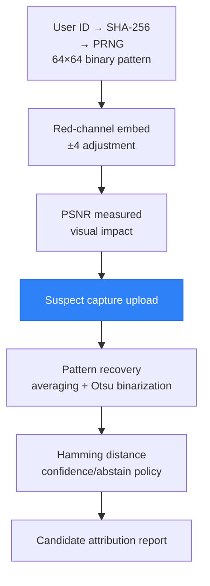

# NIRGuard

> Validation lab for off-screen leak attribution — forensic watermarking for controlled review workflows.

Patent pending. Validation-stage research, not a finished product.

한국어판(기본): [README.md](README.md)

## The Problem

Every DRM — HDCP, Widevine, FairPlay — has a blind spot: pointing a camera at a screen.
This is the analog hole. Once content becomes light, purely digital protection no longer
sees the copy path.

NIRGuard explores forensic watermarking for controlled review workflows — pre-release
media, confidential documents, design reviews, game builds, and internal security reviews —
so that a recaptured screen photo or video can be traced back to a review session.

## Approach

A user/session-specific pattern is embedded into the visual signal as a low-amplitude
red-channel adjustment, then recovered from a suspect capture and matched against
registered patterns under an abstain-aware confidence policy.



This is visible-light, spatial-domain watermarking. The project makes no physical
near-infrared emission claims: whether a display panel emits any usable NIR signal at all
is an open empirical question, gated behind the spectral measurement defined in
docs/HARDWARE_TEST_BENCH.md.

## Current Validation Status

All robustness numbers so far come from digital simulation (JPEG compression, Gaussian
noise, downscaling) — not from real optical recapture. Accuracy claims are not used until
they reproduce in the validation harness.

| Area | Status |
|------|--------|
| User-specific pattern generation | Implemented |
| Watermark insertion/extraction (pixel and block modes) | Implemented |
| Confidence / abstain attribution policy | Implemented |
| Synthetic robustness harness | Implemented — pixel mode fails combined degradation; block mode under tuning |
| FastAPI demo server + Next.js UI | Implemented |
| Real-capture recovery (smartphone, protocol-driven) | Planned — docs/REAL_CAPTURE_PROTOCOL.md |
| Spectral premise measurement | Planned — docs/HARDWARE_TEST_BENCH.md |
| Third-party validation | Not yet |

## Tech Stack

| Layer | Technology |
|-------|------------|
| Core | Python 3.11+, NumPy, OpenCV |
| API | FastAPI, Uvicorn |
| Demo UI | Next.js 14, React, TypeScript, Tailwind CSS |
| Storage | SQLite |
| Testing | pytest |

## Repository Structure

```
nirguard/
├── watermark/          # Core pipeline: generate, embed, extract, decide
├── matching/           # Pattern DB and candidate matching
├── api/                # FastAPI demo server (local use only)
├── demo/               # Next.js demo UI
├── tools/              # Validation lab CLI
├── experiments/        # Experiment manifests and local results
├── tests/              # Unit and robustness tests
└── docs/               # Validation plans and protocols
```

## Quick Start

### 1. Python API server

```bash
pip install -r requirements.txt
uvicorn api.main:app --reload --port 8000
```

The API server is a local demo tool. It has no authentication layer and must not be
deployed to a public network.

### 2. Demo UI

```bash
cd demo
npm install
npm run dev
# → http://localhost:3000
```

### 3. Tests

```bash
python3 -m pytest tests/ -v

# Robustness table (BER across degradation conditions)
python3 tests/robustness_test.py --quick
```

## Validation CLI

```bash
# Run one validation experiment
python3 tools/run_experiment.py --input path/to/image.png --user-id user_003 --mode block

# Run a batch manifest
python3 tools/run_manifest.py --manifest experiments/manifests/example_batch_manifest.json

# Run a multi-frame experiment
python3 tools/run_video_experiment.py --input path/to/video.mp4 --user-id user_003 --mode block

# Prepare a real-capture kit for phone testing
python3 tools/create_capture_kit.py --input path/to/image.png --user-id user_003 --out-dir experiments/datasets/case_001

# Summarize results / sweep thresholds / build evidence artifacts
python3 tools/analyze_results.py --results-dir experiments/results
python3 tools/threshold_sweep.py --results-dir experiments/results --output experiments/results/threshold_sweep.json
python3 tools/generate_report.py --result experiments/results/run.json --output experiments/results/report.pdf
python3 tools/build_verification_package.py --results-dir experiments/results --out-dir validation_package
```

Claim rules for reporting results live in docs/CLAIMS_POLICY.md; the external validation
protocol lives in docs/EXTERNAL_VALIDATION_PACKAGE.md.

## API Endpoints

| Method | Path | Description |
|--------|------|-------------|
| `POST` | `/api/embed` | Embed watermark → returns PSNR |
| `POST` | `/api/simulate` | Recapture degradation simulation |
| `POST` | `/api/extract` | Recover pattern + rank candidates |
| `GET` | `/api/health` | Health check + DB status |

Interactive docs: `http://localhost:8000/docs`

## Roadmap

- Real-capture dataset collection per docs/REAL_CAPTURE_PROTOCOL.md, with per-condition BER
- Spectral premise measurement per docs/HARDWARE_TEST_BENCH.md (settles the NIR question)
- Threshold/ECC tuning against the false-positive and abstain-rate targets in docs/VALIDATION_PLAN.md
- External validation round per docs/EXTERNAL_VALIDATION_PACKAGE.md

Each milestone is tied to the metrics defined in docs/VALIDATION_PLAN.md.

## Intellectual Property and License

Patent pending (Korean Intellectual Property Office). NIRGuard is a project name of the
author.

Copyright (c) 2026 KangKeun Park. All rights reserved. This repository is published for
research transparency and validation review. No license — express or implied, including
any patent license — is granted. See LICENSE.

## Contact

Licensing, pilot, and research collaboration inquiries: pkk062300@naver.com
